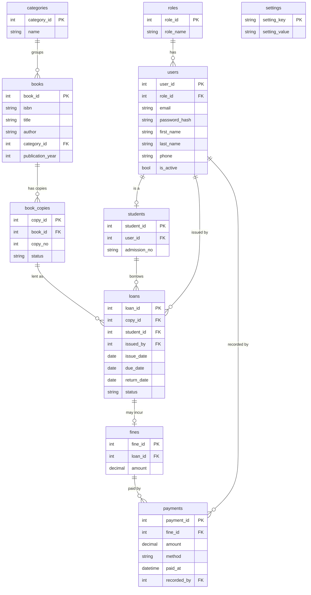

# Starter material for your project report

Adapt the wording to your own objectives (Chapter 1) – the lecturer expects requirements to trace back to them.
Screenshots, wireframes and the "Actual result" column must come from you running the system.

## ERD (Mermaid – renders on GitHub, or paste into https://mermaid.live to export an image)

3NF notes: fine balances/status and loan "overdue" status are *derived* in views (`vw_fines`, `vw_loans`),
so no value is stored twice. Student name/email live only in `users`.

## Functional requirements

| ID | The system shall… |
|---|---|
| FR1 | require login with email and password, and allow logout. |
| FR2 | store passwords only as salted hashes. |
| FR3 | support two roles (Librarian, Student) with different permissions. |
| FR4 | let a librarian add, view, update, search and deactivate/delete students. |
| FR5 | let a librarian add, view, update, search and delete books and manage the number of copies. |
| FR6 | let a librarian issue an available copy to an eligible student and calculate the due date. |
| FR7 | let a student borrow an available book after confirming the borrowing rules. |
| FR8 | let a librarian record a return, free the copy and automatically calculate any late fine. |
| FR9 | let a student request a return and see only their own loans, fines and payments. |
| FR10 | let a librarian record fine payments and show balances automatically. |
| FR11 | search and filter books, students, loans and fines. |
| FR12 | validate input (empty, malformed, duplicate, out-of-range) with clear messages. |
| FR13 | provide seven reports that can be exported to CSV or printed. |
| FR14 | let a librarian configure loan period, fine rate, borrowing limit and currency. |
| FR15 | let a librarian back up and restore the database. |

## Non-functional requirements

| Category | Requirement / target |
|---|---|
| Usability | Consistent green theme and layout; main tasks reachable from the sidebar in ≤ 2 clicks; confirmation before destructive actions. |
| Performance | Search and save operations complete in < 3 s for up to 10,000 books. |
| Security | Login required; role checks in the service layer; PBKDF2 hashes; parameterised SQL. |
| Reliability | All database calls wrapped in Try/Catch; borrow, return and payment run in transactions (all-or-nothing). |
| Data integrity | Primary/foreign keys, UNIQUE (email, ISBN, admission no), CHECK constraints, required fields in DB and forms. |
| Maintainability | Option Strict/Explicit On; UI, business and data layers separated; shared UI helpers; unit tests. |
| Portability | Windows 10/11, .NET 8, MySQL 8.0+. |
| Scalability | Normalised schema; copies tracked per physical book; indexes on loans. |
| Accessibility | 10 pt Segoe UI, high contrast green/white, logical tab order, Enter/Esc in dialogs. |

## Traceability table (example – replace with your objectives)

| Objective | Functional | Non-functional |
|---|---|---|
| 1. Secure access for librarians and students | FR1, FR2, FR3 | Security |
| 2. Manage students and books | FR4, FR5, FR11, FR12 | Usability, Data integrity |
| 3. Automate issuing, returning and fines | FR6, FR7, FR8, FR9, FR10 | Reliability, Performance |
| 4. Provide reports and settings | FR13, FR14, FR15 | Maintainability, Portability |

## Test plan (fill in "Actual result" and "Pass/Fail" while testing)

| # | Test case | Test data | Expected result | Actual | P/F |
|---|---|---|---|---|---|
| T1 | Login with wrong password | alice@school.com / wrong | "Invalid email or password." | | |
| T2 | Login with empty fields | (blank) | "Email is required." | | |
| T3 | Student cannot reach librarian data | Log in as student, inspect sidebar | Only student menu items shown; service calls refuse librarian actions | | |
| T4 | SQL injection in login | `' OR 1=1 --` as email | Login fails, no error crash | | |
| T5 | Add student with empty name | First name blank | "First name is required." | | |
| T6 | Add student with duplicate email | alice@school.com | "Another account already uses this email address." | | |
| T7 | Add student with bad phone | "abc" | "Phone must contain 9 to 15 digits." | | |
| T8 | Add book with duplicate ISBN | 978-0132350884 | "A book with this ISBN already exists." | | |
| T9 | Add book with 3 copies | valid data, copies = 3 | Book listed with Copies 3, Available 3 | | |
| T10 | Issue book to student | Alice, Calculus | Loan created; available copies drops by 1 | | |
| T11 | Issue to student with overdue book | Bob | "Overdue books must be returned before borrowing more." | | |
| T12 | Exceed borrowing limit | Borrow 4 books as one student (limit 3) | "Borrowing limit reached (3 books at a time)." | | |
| T13 | Return on time | Alice's Clean Code today | No fine; copy available again | | |
| T14 | Return 16 days late | Bob's The Hobbit | Fine = 16 × fine per day created | | |
| T15 | Pay more than balance | Carol, balance 40.00, pay 50 | "The payment cannot be more than the outstanding balance." | | |
| T16 | Part payment | Carol pays 10 | Status stays "Partially Paid", balance 30.00 | | |
| T17 | Student request return | Alice, My Borrowed Books | Status "Return Requested"; copy still borrowed | | |
| T18 | Delete student with history | Carol | Account deactivated, history kept | | |
| T19 | Change password with mismatch | new ≠ confirm | "The new password and its confirmation do not match." | | |
| T20 | Export report to CSV | Outstanding Fines | CSV opens in Excel with correct rows | | |
| T21 | Boundary: loan period 0 | Settings = 0 (not possible) / 366 | Control limits 1–365 | | |
| T22 | Backup then restore | Backup, change data, restore | Data returns to backup state | | |

Usability testing: ask at least three people to complete "borrow a book" and "record a payment"; note their
feedback and the changes you made.

Run `dotnet test` (or Test Explorer in Visual Studio) for the automated tests listed in `LibraryManagement.Tests`.
